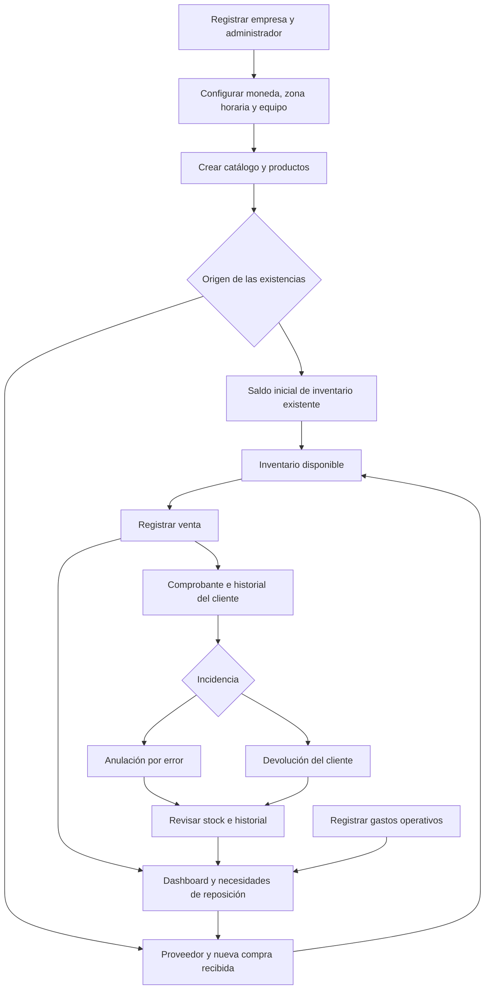

> Estado posterior a las correcciones: consultar [CIERRE_RIESGOS.md](CIERRE_RIESGOS.md). Este documento conserva la auditoría original.

# Análisis funcional del CRM: capacidades, flujos, límites y prioridades

**Fecha:** 18 de octubre de 2026.  
**Código revisado:** `crm_frontend` y `crm_django`, en sus carpetas locales.  
**Objetivo:** decidir qué corregir, qué completar y qué conviene implementar según el negocio.

## 1. Conclusión para tomar decisiones

El proyecto ya reúne una base amplia de **gestión comercial para una tienda**: clientes, productos, inventario, ventas, compras, proveedores, gastos, reportes y usuarios. Además tiene devoluciones parciales, movimientos de inventario, recomendaciones y envío de promociones.

La prioridad recomendada es **hacer consistentes las operaciones que ya existen antes de añadir módulos grandes**. Hay diferencias entre el stock, su historial, las devoluciones y algunos cálculos de recomendaciones que pueden producir información contradictoria. También hay comportamientos de eliminación y envío de correos que requieren corrección.

Si el objetivo es gestionar un comercio pequeño, no hace falta implementar inmediatamente FIFO, inteligencia artificial, múltiples almacenes ni automatizaciones comerciales complejas. Si el objetivo es un CRM para equipos de ventas, faltan funciones centrales: prospectos, oportunidades, etapas, tareas y seguimiento de contactos. Si el objetivo es venderlo como SaaS, queda trabajo de suscripciones, cobros, operación y soporte.

**Valoración:** funcionalidad suficiente para preparar un piloto controlado después de resolver los puntos P0; esta revisión no certifica que todos los flujos actuales estén listos para operar sin supervisión.

### Cómo leer el documento

- **Secciones 3 y 4:** qué existe y quién puede usarlo.
- **Sección 5:** cómo debería utilizarlo una empresa, paso a paso.
- **Sección 6:** límites que deben conocerse para interpretar los datos.
- **Sección 7:** problemas encontrados, con evidencia y criterio de solución.
- **Secciones 8 y 9:** qué implementar según el negocio y en qué orden.
- **Sección 10:** decisiones pendientes que conviene responder antes de ampliar el producto.

## 2. Alcance y nivel de certeza

Este documento se basa en lectura de modelos, API, validaciones, servicios de análisis, rutas, páginas, formularios, pruebas existentes y documentación. Se excluyeron carpetas de dependencias y archivos generados. No se consultaron datos privados de la base ni se enviaron correos.

**No se ejecutaron pruebas ni se inspeccionó el despliegue en esta revisión.** Los hallazgos marcados como observados corresponden a rutas de código identificadas; los ejemplos explican consecuencias deducidas de ellas, no incidentes confirmados en producción. Los criterios de aceptación son comprobaciones propuestas para cuando se realicen las correcciones.

La documentación anterior tiene diferencias importantes:

- `OPERACION_MVP.md` y `REVISION_Y_PLAN.md` todavía dejan compras, proveedores y devoluciones parciales fuera del alcance; esas funciones ahora sí están en el código.
- `PROGRESS.md` registra avances posteriores y afirma que se ejecutó CI con PostgreSQL. Esa afirmación documental no se verificó contra GitHub en este análisis.
- Las secciones antiguas de `PROGRESS.md` describen ventas en dos pasos y otras limitaciones ya superadas. No deben usarse como descripción del comportamiento actual.

Cuando haya contradicción, este documento describe el código local observado. Que una función exista en código no demuestra que esté desplegada, configurada o validada con datos reales.

## 3. Inventario de funcionalidades actuales

### 3.1 Acceso, empresa y usuarios

| Función | Qué permite actualmente | Límite o matiz |
| --- | --- | --- |
| Registro de empresa | Crear empresa y primer administrador, con inicio de sesión automático | No hay verificación de correo ni invitaciones de equipo como flujo independiente |
| Inicio de sesión | Autenticación con usuario y contraseña, tokens y renovación de sesión | Un usuario pertenece a una empresa; no hay selector de múltiples empresas para la misma cuenta |
| Recuperación de contraseña | Solicitar enlace y establecer una nueva contraseña | Necesita un servicio de correo configurado y comprobar entrega real |
| Cambio de contraseña | Validar contraseña actual y cambiarla; invalidar tokens anteriores mediante comprobación de contraseña | No hay una pantalla de dispositivos/sesiones abiertas |
| Usuarios | Crear, editar rol/datos, desactivar y reactivar | La desactivación conserva el historial; la reactivación no vuelve a comprobar el límite del plan |
| Protección administrativa | Evita desactivar/cambiar el rol de la propia cuenta y dejar la empresa sin administrador activo | No equivale a una bitácora completa de cambios de permisos |
| Separación por empresa | Consultas y relaciones de negocio restringidas por empresa en los flujos revisados | Debe seguir comprobándose cada vez que se agregue un endpoint |
| Datos de empresa | Nombre comercial, razón social, contacto, dirección, país, web y descripción | Existen campos adicionales en el modelo, como logo, sin un flujo completo visible de carga en la página revisada |
| Preferencias | Moneda, zona horaria y formato regional | Cambiar moneda cambia la presentación; no convierte importes existentes |
| Administración de plataforma | Django Admin y catálogos globales para superusuario | Tiene acceso a modelos transaccionales; necesita restricciones adicionales para evitar saltarse reglas de negocio |

### 3.2 Clientes y catálogo

| Función | Qué permite actualmente | Límite o matiz |
| --- | --- | --- |
| Clientes | Alta, edición, eliminación, contacto, dirección y notas | No hay búsqueda/fusión de duplicados como proceso de negocio |
| Ficha del cliente | Información e historial de ventas, con resumen de compras | No es una cronología de llamadas, conversaciones, tareas y oportunidades |
| Catálogo | Categorías → subcategorías → tipos de producto | La clasificación es opcional para el producto; borrar padres puede dejar productos sin clasificación |
| Productos | Nombre, descripción, precio, costo inicial, stock inicial, stock mínimo y estado activo | No hay SKU/código de barras, variantes, unidades fraccionarias ni lotes como modelos específicos |
| Estado de producto | Desactivar un producto para no seleccionarlo en nuevas ventas | No elimina su historial; no debe confundirse con eliminarlo |
| Búsqueda y páginas | Listas principales con búsqueda y paginación | Algunos selectores y el Kardex siguen descargando listas completas |

### 3.3 Inventario, compras y proveedores

| Función | Qué permite actualmente | Límite o matiz |
| --- | --- | --- |
| Stock inicial | Crear producto con cantidad y registrar movimiento inicial | Los productos anteriores a la incorporación del Kardex no reciben automáticamente un saldo de apertura en la migración revisada |
| Reposición manual | Sumar unidades y, opcionalmente, su costo | No representa una compra con proveedor ni un pago; no duplicar esta entrada con una compra del mismo lote |
| Costo promedio | Recalcular promedio ponderado al ingresar mercadería con costo | Las devoluciones y cancelaciones no ajustan el valor promedio del stock que regresa |
| Stock mínimo | Umbral configurable por producto y alertas visuales | No incluye plazo de entrega del proveedor, stock reservado ni pedidos pendientes |
| Ajustes | Entrada, salida, daño y pérdida/merma; no permite terminar con stock negativo | El motivo es opcional; no hay autorización separada, valoración contable de merma ni sesión de inventario físico |
| Kardex | Consultar entradas/salidas por producto o globales y exportarlas | No registra todavía todos los caminos que modifican stock; ver H02 |
| Proveedores | Datos de contacto, alta, edición y eliminación | Borrarlos puede quitar la asociación visible de compras históricas; preferir desactivación |
| Compras | Registrar varias líneas, cantidades y costos; actualizar stock y costo dentro de una transacción | Se registra una recepción inmediata, no una orden pendiente con recepciones parciales |
| Consulta de compras | Tabla, búsqueda, páginas y CSV; API con artículos de cada compra | La pantalla no tiene un detalle de compra equivalente al detalle de venta |
| Eliminación de compra | Administrador puede borrar el registro | No revierte stock/costo; es un punto crítico, no una cancelación válida |

### 3.4 Ventas, devoluciones y gastos

| Función | Qué permite actualmente | Límite o matiz |
| --- | --- | --- |
| Crear venta | Cliente opcional, productos, cantidades, método de pago opcional y notas | Se registra como completada; no hay borrador, cotización, pedido pendiente ni reserva |
| Consistencia de venta | Todos los artículos se crean juntos; valida disponibilidad y descuenta stock | La creación no tiene una clave de idempotencia para reconocer reintentos de la misma operación |
| Precio y costo de venta | Guarda precio/costo en cada línea para análisis históricos | La API acepta precio por línea; no hay política separada de autorización de descuentos |
| Detalle de venta | Artículos, importes, cliente, método de pago, notas y devoluciones | El nombre del producto se toma del catálogo actual, no de una copia histórica del nombre |
| Cancelación/reactivación | Devuelve/descuenta stock; reactivar exige disponibilidad | No registra por sí misma un reembolso real; faltan movimientos compensatorios en Kardex |
| Devolución parcial | Devuelve unidades, reduce cantidad/subtotal/total y guarda motivo e importe de devolución | Siempre reintegra al stock disponible y cambia el total de la venta original |
| Devolución total | Cancela automáticamente cuando no quedan unidades; impide reactivarla | El estado no distingue claramente una venta anulada de una completamente devuelta |
| Comprobante | Imprimir el detalle con el navegador | No constituye un módulo de facturación fiscal; incluye costo unitario en la vista imprimible actual |
| Gastos | Alta, edición, eliminación, categoría, monto, método de pago y notas | No tiene aprobación, recurrencia, adjuntos ni cuentas por pagar |
| Categorías de gasto | Crear/editar y activar/desactivar | El backend impide eliminar categorías protegidas por gastos asociados |

### 3.5 Dashboard, recomendaciones, correos y planes

| Función | Qué permite actualmente | Límite o matiz |
| --- | --- | --- |
| Períodos | Mes, año, intervalo y comparación contra otras fechas/mes/año | Los cambios se aplican mediante el botón; no todos los indicadores representan el mismo horizonte temporal |
| Ventas | Totales, unidades, ticket, evolución, productos destacados, categorías y métodos de pago | Las devoluciones alteran cifras de la fecha original de la venta |
| Clientes | Nuevos, activos, recurrentes, inactivos y principales compradores | Recurrentes usa historia completa; inactividad usa 60 días respecto al momento actual |
| Productos | Bajo stock, agotados, sin ventas en período, poca rotación, margen y costos faltantes | El stock es actual; el margen solo utiliza líneas con costo conocido |
| Gastos | Totales, categorías, evolución y comparación con ventas | Compras de mercadería y pagos de compras no están integrados como flujo de caja |
| Reportes | CSV de tablas, CSV de página en listados e impresión del dashboard | Exportar página no equivale a exportar todos los registros; algunas tablas son rankings limitados |
| Recomendaciones | Pares frecuentes, reposición estimada, margen, reactivación de clientes y relación gastos/ventas | Reglas y agregaciones deterministas, no un modelo de IA; hay un error de cálculo tras devoluciones |
| Resumen por correo | Enviar al correo del usuario, empresa o destinatarios internos según disponibilidad | Envío síncrono; no hay historial de entrega, cola ni reintentos controlados |
| Alertas de stock por correo | Se disparan después de crear una venta | Pueden repetirse en ventas sucesivas; no hay enfriamiento de alertas ni confirmación de entrega |
| Promociones | Mensaje personalizado a todos, clientes inactivos o compradores relacionados | Falta vista previa de destinatarios, bajas y seguimiento; hay ampliación automática de segmento vacío a todos |
| Plan y suscripción | Consultar estado, fechas, precio y uso; limitar creación de usuarios/productos | No hay checkout, cobro recurrente, facturas del servicio ni suspensión comercial completa |

**Función implementada pero poco accesible:** las empresas nuevas se crean con recomendaciones desactivadas. La página de preferencias no ofrece un control para activarlas y el componente desaparece si están desactivadas. Actualmente su habilitación requiere API o administración de plataforma. Esto afecta también al acceso visible a promociones desde esa sección.

## 4. Roles y permisos reales

La siguiente matriz describe el comportamiento revisado. No todos los permisos coinciden entre interfaz y API.

| Operación | Administrador | Gerente | Vendedor | Empleado |
| --- | --- | --- | --- | --- |
| Consultar clientes, catálogo, productos y ventas de la empresa | Sí | Sí | Sí | Sí |
| Crear/editar clientes | Sí | Sí | Sí | No |
| Crear/editar catálogo y productos | Sí | Sí | No | No |
| Reponer y ajustar inventario | Sí | Sí | No | No |
| Consultar Kardex | Sí | Sí | Sí | Sí |
| Crear ventas | Sí | Sí | Sí | No |
| Cancelar/reactivar/devolver ventas | Sí | Sí | No | No |
| Eliminar ventas y productos | Sí | No | No | No |
| Crear/consultar compras | Sí | Sí | No | No |
| Eliminar compras | Sí | No | No | No |
| Crear/editar proveedores | Sí | Sí | No | No |
| Consultar proveedores | Sí | Sí | API solamente | API solamente |
| Crear/editar gastos | Sí | Sí | No | No |
| Eliminar gastos/categorías de gasto | Sí | Sí | No | No |
| Dashboard, recomendaciones y envíos comerciales | Sí | Sí | No | No |
| Ver suscripción | Sí | API lo permite; pestaña oculta | No | No |
| Configurar empresa y gestionar usuarios | Sí | No | No | No |
| Cambiar contraseña propia | Sí | Sí | Sí | Sí |

**Decisiones relevantes:**

1. Vendedor y Empleado pueden consultar ventas de toda su empresa; no existe restricción a “mis ventas”.
2. El costo está expuesto en productos y líneas de venta, también para roles de consulta. Ocultar una columna no sería suficiente si se decide restringirlo: habría que ajustar la API.
3. Los métodos de pago y otros catálogos globales dependen del superusuario. Una empresa no administra libremente sus propias cuentas/cajas/métodos.
4. Un superusuario tiene facultades de plataforma; no debe usarse como cuenta diaria de un negocio.
5. Gerente puede borrar gastos y sus categorías, aunque no pueda borrar ventas o productos. Es una excepción real a la regla informal de “solo Administrador elimina”; conviene decidir si se conserva.

Evidencia: [permisos de API y vistas](../crm_django/core/views.py), [reglas de roles](../crm_django/core/permissions.py), [permisos del frontend](src/lib/permissions.ts), [Configuración](src/pages/SettingsPage.tsx).

## 5. Flujo de uso propuesto

Este es el flujo recomendado con la base existente. Las correcciones pendientes se indican para no confundir el flujo deseado con una garantía actual.

### 5.1 Puesta en marcha de una empresa

1. Registrar empresa y administrador.
2. Revisar nombre, contacto, moneda y zona horaria **antes de cargar operaciones**.
3. Crear usuarios con su rol, evitando compartir una única cuenta.
4. Crear categorías y productos. Definir precio, stock mínimo y costo si se conoce.
5. Elegir cómo incorporar mercadería existente: saldo inicial, o una compra si se quiere documentar esa adquisición. **No registrar ambos para las mismas unidades.**
6. Crear proveedores y categorías de gasto.
7. Revisar quién puede consultar costos, hacer devoluciones y ajustar stock.
8. Confirmar recuperación de cuenta y procedimiento de respaldo en el entorno donde se utilizará.

**Mejora recomendada:** una lista de configuración inicial con estados pendientes y enlaces, en lugar de exigir al usuario que descubra este orden.

### 5.2 Compra y recepción de mercadería

1. Administrador/Gerente selecciona o crea un proveedor.
2. Abre Compras → Nueva compra y agrega productos, cantidades y costos.
3. Revisa todas las líneas antes de guardar. Hoy el formulario puede omitir líneas incompletas: corregir H09.
4. Al confirmar, la API agrega inmediatamente existencias y recalcula costo promedio.
5. Verifica cantidad y movimiento en Productos/Kardex.
6. Registra el pago en el control externo correspondiente mientras no exista caja/cuentas por pagar. Registrar un método de pago no demuestra que la compra esté pagada.

**Si hubo un error:** no utilizar “Eliminar compra” como si anulara recepción y costo. Se necesita el flujo de reversión descrito en H01.

### 5.3 Venta diaria

1. Vendedor/Administrador/Gerente entra a Ventas → Nueva venta.
2. Selecciona cliente si se necesita historial, o realiza venta sin cliente.
3. Agrega productos y cantidades, revisa total y método de pago.
4. Confirma una vez. El backend vuelve a validar el stock y crea la venta completa.
5. Consulta el detalle y entrega un comprobante adecuado al cliente. Corregir exposición de costo en impresión antes de entregarlo externamente.
6. Si la pantalla tarda o falla después de confirmar, revisar primero el listado antes de reintentar: todavía no hay deduplicación del pedido.

**Límite:** no hay cobro integrado, saldo pendiente, vuelto, pagos divididos ni reserva de productos. “Completada” describe la venta registrada, no una conciliación bancaria.

### 5.4 Anulación, devolución y mercadería dañada

| Situación | Uso esperado | Precaución actual |
| --- | --- | --- |
| Venta registrada por error | Anular conservando referencia, usuario y motivo | Falta motivo/registro completo del cambio de estado en Kardex |
| Cliente devuelve parte de la compra | Registrar devolución por línea y motivo | El sistema devuelve siempre al stock vendible; no distingue condición del artículo |
| Cliente devuelve todo | Registrar todas las unidades; conservar comprobante original y devolución | Actualmente se cancela la venta y se modifica su total histórico |
| Producto devuelto dañado | Devolución con destino a merma o cuarentena | No existe ese destino integrado; devolución + ajuste por daño son dos operaciones separadas y no atómicas |
| Reembolso al cliente | Registrar medio, importe, fecha y estado de pago | El importe calculado en `SaleReturn` no ejecuta ni concilia el pago |

Hasta corregir estos puntos, una devolución requiere revisar cantidad, stock y reembolso real de forma conjunta. La anulación y la devolución deberían tener estados y documentos distintos.

### 5.5 Revisión diaria y semanal

**Diaria:** revisar ventas registradas, incidencias, gastos, agotados y ajustes de inventario. No utilizar el dashboard como cierre de caja: no representa todos los movimientos de dinero.

**Semanal:** revisar ventas por producto/categoría, costos faltantes, necesidades de reposición, clientes sin compras recientes y gastos. Registrar decisiones de compra, no aceptar automáticamente una sugerencia de reposición.

**Mensual:** comparar períodos y exportar reportes con alcance claro. Tener presente que una devolución posterior puede cambiar el mes de la venta original. Un cierre histórico reproducible necesita una regla adicional.

### 5.6 Promociones y seguimiento comercial

Flujo recomendado antes de habilitar campañas reales: seleccionar segmento → ver destinatarios y cantidad → revisar mensaje → confirmar → registrar resultado por destinatario → respetar bajas → evitar duplicados en reintentos.

Actualmente solo existe parte de este flujo: selección, mensaje y envío. No utilizar el segmento “compradores relacionados” como garantía de audiencia acotada hasta corregir H05.

## 6. Límites que afectan las decisiones del negocio

### 6.1 Dinero, costo y rentabilidad

- **Ventas menos gastos no es utilidad neta ni saldo de caja.** El resumen resta gastos registrados a ventas; no incorpora compras como pagos, impuestos, cuentas pendientes ni todos los efectos financieros de devoluciones.
- El margen por producto usa el costo almacenado en las líneas conocidas. Si falta costo en parte de las ventas, el margen disponible es parcial.
- Comprar inventario y registrar un gasto son operaciones distintas. No duplicar el costo de mercadería como gasto sin una regla de reportes definida.
- La moneda es una preferencia global de presentación. Cambiar BOB a USD vuelve a mostrar los mismos números como USD; no hay cotización ni moneda por transacción.
- Las cantidades son enteras. El modelo no representa adecuadamente venta por peso, metros o fracciones sin cambios.
- Una reposición sin costo conserva el promedio existente. Si ya había stock de costo desconocido, una entrada posterior con costo no resuelve automáticamente esa incertidumbre.
- No existe un proceso formal para corregir un costo inicial desconocido con stock remanente y conservar auditoría. Hace falta definirlo si ocurre frecuentemente.

### 6.2 Tiempo e historia

- Stock bajo/agotado describe el presente, aunque el dashboard muestre un mes pasado.
- Clientes recurrentes usa historia completa; clientes inactivos usa 60 días desde ahora.
- Pares frecuentes analiza las últimas 500 ventas completadas, no exclusivamente el período seleccionado. Muestra los cinco pares principales.
- Reposición sugerida usa ventas del período, cobertura estimada y un objetivo de aproximadamente 30 días; muestra hasta cinco sugerencias. No conoce estacionalidad, plazos de proveedor ni pedidos en tránsito.
- Nombres/clasificación de productos y datos del cliente provienen de relaciones actuales. Renombrar, reclasificar o eliminar referencias puede cambiar cómo se presenta el historial.
- El Kardex incorporado después de operaciones antiguas no es automáticamente un libro completo desde el inicio.

### 6.3 Capacidad y operación

- La API pagina cuando se solicita `page`: 25 registros por defecto, máximo 100 mediante `page_size`. Sin `page` devuelve la lista completa en los endpoints que usan esa base.
- No hay un volumen máximo de clientes, productos o ventas validado en esta revisión. No prometer capacidad ilimitada por usar paginación en algunas pantallas.
- El Kardex y varios selectores pueden crecer sin límite práctico en la respuesta; el dashboard también tiene listas no acotadas.
- No hay modo sin conexión ni sincronización posterior.
- No hay sucursales, almacenes, transferencias, reservas, lotes, caducidades o seriales como entidades de negocio.
- El campo de imagen/logo existe, pero no debe considerarse un módulo completo de gestión de archivos por sí solo.
- Exportar una página o un ranking no sustituye una copia de seguridad ni una exportación total de empresa.

### 6.4 Límite comercial de los planes

Actualmente los límites se aplican al crear recursos con una suscripción activa o de prueba vigente. Sin suscripción vigente, incluso si venció o se canceló, la empresa queda **sin límites**. Esto está reflejado también en las pruebas existentes; no es una suspensión comercial.

Usuarios cuenta solo activos; productos cuenta todos, incluidos inactivos. No hay cobro automático, actualización de plan por pago, períodos de gracia ni gestión de impagos. El plan requiere administración manual de plataforma.

## 7. Hallazgos y correcciones priorizadas

### Escala de prioridad

- **P0:** resolver antes de utilizar el flujo afectado con datos reales sin supervisión.
- **P1:** completar para un piloto estable o antes de escalar el uso.
- **P2:** mejora conveniente; priorizar por frecuencia y beneficio real.
- **Condicional:** vital solo si ese uso forma parte del producto que se va a ofrecer.

El tamaño indicado es relativo: **S** cambio acotado, **M** varias capas, **L** reglas/modelos/migración. No representa una estimación de días.

### H01 — Eliminar una compra conserva sus efectos en stock y costo

**P0 · Observado en código · M/L.** `PurchaseViewSet` permite borrar; utiliza la eliminación general, sin una reversión específica. `PurchaseItem.save()` incrementa stock y costo al crear, pero no existe la operación contraria al borrar la compra.

**Ejemplo deducido:** comprar 10 unidades y eliminar el registro deja las unidades recibidas y el costo promedio, pero pierde el documento de compra. Los movimientos pueden seguir mencionando un número de compra inexistente.

**Recomendación:** bloquear el borrado de compras registradas y diseñar anulación/nota correctiva con rastro de auditoría. Si parte de la mercadería ya se vendió, no basta con restar unidades o recuperar un promedio anterior.

**Cierre:** corregir una compra nunca deja stock/costo sin explicación; el documento original permanece consultable; se define qué hacer cuando hubo ventas posteriores.

Evidencia: [PurchaseViewSet](../crm_django/core/views.py), [PurchaseItem y Purchase](../crm_django/core/models.py), [botón de eliminar compra](src/pages/PurchasesPage.tsx).

### H02 — Kardex incompleto y pérdida de trazabilidad

**P0 · Observado en código · M.** Cancelar/reactivar cambia stock en `SaleSerializer.update()` sin crear `InventoryMovement`. Eliminar una venta devuelve stock mediante `SaleItem.delete()` sin movimiento equivalente. Borrar un producto puede borrar en cascada sus movimientos cuando no lo impidan otras relaciones.

La migración que introduce Kardex crea la tabla, pero no incorpora un saldo de apertura para inventario anterior. No se comprobó si otro proceso externo ya realizó esa carga en producción.

**Recomendación:** usar una operación común que actualice stock y movimiento juntos; registrar anulaciones y reactivaciones; impedir borrar historia; crear un saldo de apertura identificado para productos existentes.

**Cierre:** saldo inicial + suma de movimientos = stock actual después de compra, venta, reposición, devolución, anulación, reactivación y ajuste. Cada movimiento conserva actor, motivo y referencia verificable.

Evidencia: [actualización de venta](../crm_django/core/serializers.py), [eliminación de líneas y modelo de movimientos](../crm_django/core/models.py), [migración de movimientos](../crm_django/core/migrations/0006_inventory_movements.py).

### H03 — Las recomendaciones descuentan las devoluciones dos veces

**P0 si se usan sugerencias para comprar · Observado en código · S/M.** La devolución reduce `SaleItem.quantity` e incrementa `returned_quantity`. El servicio de recomendaciones vuelve a restar `returned_quantity` y filtra pares con `quantity > returned_quantity`.

**Ejemplo deducido:** se venden 5 y se devuelven 2: quedan `quantity=3` y `returned_quantity=2`; la sugerencia calcula 1 unidad vendida en vez de 3. Con devoluciones mayores puede calcular un valor negativo y omitir el producto.

**Recomendación:** definir una única representación: cantidad original y devuelta, o cantidad neta y devuelta. Ajustar todos los consumidores a esa decisión.

**Cierre:** ventas, análisis de productos, combinaciones y reposición usan la misma cantidad neta después de una o varias devoluciones.

Evidencia: [partial_return](../crm_django/core/views.py), [get_dashboard_insights](../crm_django/core/services/insight_service.py).

### H04 — Devoluciones: historia, costo y destino del artículo

**P0 para confiar en historia y valoración · Observado en código; política por definir · L.** La devolución modifica cantidad y total de la venta original, mientras los análisis la agrupan por `sale_date`. Una devolución de octubre de una venta de septiembre cambia septiembre. Se guarda un registro de devolución, pero los reportes no lo presentan como movimiento financiero de octubre.

El stock devuelto aumenta sin recalcular costo promedio. Además, `SaleItem.save()` rellena `unit_cost` desde el producto cuando es nulo, también al guardar una devolución: un costo originalmente desconocido puede adquirir un valor posterior.

**Ejemplo de valoración deducido:** se vende la última unidad con costo 10, después se compra una unidad a 20 y vuelve la unidad de costo 10. El stock pasa a 2 con costo actual 20; si se pretende reincorporar al costo histórico, el promedio esperado sería 15. La política debe decidirse expresamente.

**Recomendación:** conservar documento original, distinguir anulación y devolución, registrar fecha/importe/estado del reembolso y condición del artículo. Definir si vuelve a disponible, daño o cuarentena. Mantener inmutable el costo histórico, incluido su estado desconocido.

**Cierre:** devolución entre meses, devolución después de nuevas compras y devolución de producto dañado tienen resultados definidos; no cambian silenciosamente el costo histórico ni incorporan unidades dañadas a la venta.

Evidencia: [SaleItem.save](../crm_django/core/models.py), [partial_return](../crm_django/core/views.py), [resumen de períodos](../crm_django/core/services/overview_service.py), [análisis de productos](../crm_django/core/services/product_analytics.py).

### H05 — Un segmento de promociones vacío se transforma en todos los clientes

**P0 antes de campañas reales · Observado en código · S/M.** Para compradores relacionados sin coincidencias, el servicio usa todos los clientes activos con correo. Si se elige ese segmento sin productos, también cae en la audiencia general. El formulario permite elegirlo sin un selector propio de productos, usando los del mensaje preconfigurado o una lista vacía.

**Recomendación:** un segmento vacío debe producir cero destinatarios y una explicación. Validar productos requeridos, mostrar vista previa y cantidad, y confirmar exactamente ese grupo. Incorporar preferencia de recepción y baja antes de campañas sostenidas.

**Cierre:** elegir compradores relacionados nunca envía a personas fuera del segmento. Reintentar no duplica destinatarios ya procesados.

Evidencia: [send_customer_promotion_email](../crm_django/core/services/notification_service.py), [formulario de promoción](src/components/dashboard/SendPromotionDialog.tsx).

### H06 — Costos visibles en roles de consulta y comprobante

**P0 antes de entregar el comprobante a clientes; decisión de permisos para el equipo · S/M.** El detalle incluye costo unitario y el botón imprime esa vista. La columna de costo no está excluida de impresión. Vendedores y empleados también reciben costos en productos/líneas.

**Recomendación:** separar documento para cliente de detalle interno; decidir quién ve costos y aplicar esa decisión en API, pantalla y exportaciones.

**Cierre:** el comprobante público no muestra costos/márgenes internos y cada rol recibe únicamente los campos autorizados.

Evidencia: [detalle de venta](src/pages/SaleDetailPage.tsx), [serializadores](../crm_django/core/serializers.py), [productos](src/pages/ProductsPage.tsx).

### Otros hallazgos que deben entrar al backlog

| ID / prioridad | Hallazgo y evidencia | Acción recomendada y criterio de cierre | Tamaño |
| --- | --- | --- | --- |
| H07 · P1; vital para SaaS pago | El vencimiento elimina límites; no se verifica inicio futuro; reactivar usuarios no llama a `enforce_limit`; contar y crear no se serializa por empresa. [Servicio](../crm_django/core/services/subscription_service.py), [vistas](../crm_django/core/views.py), [usuarios](../crm_django/core/serializers.py) | Definir política de vencimiento, gracia y lectura; validar creación/reactivación y concurrencia. Dos solicitudes simultáneas no pueden superar cupo; un plan futuro no aplica antes de empezar. | M/L |
| H08 · P1; vital para operación online | No hay identificador idempotente en creación de ventas, compras o devoluciones. Los botones pendientes ayudan, pero no cubren pérdida de respuesta/reintento. [Serializadores](../crm_django/core/serializers.py) | Reconocer la misma solicitud por empresa y devolver la operación ya creada. Simular respuesta perdida y reintento sin repetir stock ni documento. | M |
| H09 · P1 | `NewPurchaseDialog` filtra líneas incompletas antes de enviar en vez de rechazarlas. [Formulario](src/components/purchases/NewPurchaseDialog.tsx) | Si una línea iniciada es inválida, señalarla y bloquear guardado; solo ignorar filas completamente vacías. El usuario confirma exactamente las líneas que ve. | S |
| H10 · P1 | Correos se envían dentro del tiempo de la petición; promociones realizan un envío por destinatario, sin registro de progreso. La alerta de stock usa `fail_silently=True`. [Notificaciones](../crm_django/core/services/notification_service.py), [creación de venta](../crm_django/core/serializers.py) | Separar entrega mediante cola/salida pendiente, registrar resultado y reintento; no duplicar campañas ni bloquear la operación comercial por lentitud de correo. No presentar número de destinatarios como prueba de entrega. | M |
| H11 · P1 | Alta de empresa desactiva recomendaciones, interfaz las oculta y preferencias no las habilita. [Signup](../crm_django/core/serializers.py), [Settings](src/pages/SettingsPage.tsx), [InsightsSection](src/components/dashboard/InsightsSection.tsx) | Crear preferencia explícita y explicación. Revisar `enable_expenses`/`enable_inventory`: existen, pero no se observó bloqueo consistente de sus módulos. | S/M |
| H12 · P1 | Hay permisos diferentes entre API y navegación para ver plan y consultar proveedores. Además, Gerente puede borrar gastos, a diferencia de ventas/productos. [Vistas](../crm_django/core/views.py), [permisos UI](src/lib/permissions.ts) | Aprobar una única matriz y hacer que interfaz y servidor coincidan, incluyendo campos de costo y excepciones de eliminación. | S/M |
| H13 · P1 | No hay límite de intentos declarado para login/registro; el límite explícito revisado es recuperación de contraseña. Logout limpia tokens locales, sin revocación de servidor visible. [Configuración](../crm_django/mi_crm/settings.py), [cliente](src/api/client.ts) | Revisar protección de endpoints públicos y política de sesiones antes de apertura amplia. Comprobar también protecciones de infraestructura: no se inspeccionaron aquí. | M |
| H14 · P1 | Django Admin registra directamente ventas, artículos, compras y movimientos. No utiliza automáticamente todos los bloqueos/validaciones de la API. [Admin](../crm_django/core/admin.py) | Hacer los documentos/movimientos de solo lectura o proporcionar acciones de negocio controladas. Conservar superusuario para soporte acotado. | M |
| H15 · P1 | No existe auditoría transversal para precio, costo, roles, preferencias, borrados y cambios de estado. El Kardex es parcial y específico de inventario. | Registrar actor, fecha, motivo y valores relevantes; evitar eliminación física de documentos operativos confirmados. | M/L |
| H16 · P2, P1 con más volumen | Selectores y Kardex sin paginación efectiva, datos relacionados descargados completos y rankings exportados sin un exportador total. [API base](../crm_django/core/api.py), [Kardex](src/components/products/InventoryMovementsDialog.tsx) | Búsqueda remota, filtros por fecha/estado/proveedor, exportación de todo el conjunto filtrado con límites explícitos. Medir con volumen esperado. | M |
| H17 · P2 | Una reposición con costo cero puede mostrar otro costo en el movimiento por usar `unit_cost or product.cost`. [restock](../crm_django/core/views.py) | Distinguir cero de valor ausente. El movimiento de entrada gratuita conserva costo unitario cero. | S |
| H18 · P2 | Cliente/proveedor/categoría pueden perder asociaciones históricas al borrarse; falta detalle de compra y ciertos campos del modelo no tienen control visible. | Priorizar desactivar sobre borrar, previsualizar impacto y completar detalle de compra. Exponer solo campos que el negocio realmente usará. | M |

## 8. Qué podría faltar de forma vital, según el negocio

| Necesidad | Cuándo es vital | Situación actual | Decisión recomendada |
| --- | --- | --- | --- |
| Cuadre de caja por turno | Tienda que cobra efectivo y necesita detectar diferencias | No hay apertura, cierre, ingresos/retiros ni conciliación | Priorizar después de consistencia de stock; definir si el CRM será también caja/POS |
| Cuentas por cobrar y abonos | Se vende al crédito | No hay saldo, vencimiento ni pagos parciales | Implementar antes de registrar crédito como si fuera venta cobrada |
| Cuentas por pagar | Se compra a crédito | Compra tiene total/método, pero no deuda ni vencimiento | Implementar junto con registro de pagos si proveedores dan crédito |
| Facturación e impuestos | Debe emitir documentos fiscales desde el sistema | Solo impresión de detalle | Definir jurisdicción y requisitos con el negocio antes de diseñar; no se evaluó normativa en esta revisión |
| Cotizaciones y pedidos | La venta requiere aceptación previa o entrega posterior | Solo venta completada | Agregar estados y reglas de reserva/entrega si ese flujo existe |
| Prospectos, oportunidades y tareas | El objetivo es gestionar un equipo comercial con seguimiento | Cliente e historial de venta; no hay embudo comercial | Es central para un CRM de ventas; opcional para una tienda de venta inmediata |
| Historial de contactos | Hay llamadas, WhatsApp, reuniones y compromisos | Notas libres, sin actividades fechadas y responsables | Empezar con actividad, responsable y próxima acción antes de integrar canales |
| SKU/código de barras | Catálogo amplio, caja rápida o nombres parecidos | Identificación por ID/nombre | Prioridad alta si el negocio necesita distinguir variantes y escanear |
| Unidades/variantes | Venta a granel, tallas, colores o conversiones de unidades | Cantidades enteras por producto | Definir modelo antes de cargar un catálogo que dependa de ello |
| Lotes y vencimientos | Alimentos, medicamentos u otros productos con trazabilidad por lote | No implementado | Vital solo para negocios que lo requieren; promedio ponderado no reemplaza trazabilidad |
| FIFO | El negocio exige identificar/costear unidades por orden de entrada | Promedio ponderado | Posponer salvo necesidad concreta; no es solución a un Kardex incompleto |
| Múltiples almacenes | Hay stock en varias ubicaciones y transferencias | Una cantidad por producto/empresa | Implementar antes de mezclar ubicaciones; no usar empresas separadas como sustituto accidental |
| Importación y deduplicación | Migración desde Excel o catálogos grandes | Sin asistente de carga revisado | Priorizar al incorporar el primer negocio real con datos existentes |
| Cobro de suscripciones | Se vende acceso recurrente a otras empresas | Consulta/limitación parcial y administración manual | Definir primero política comercial; luego pagos, eventos de cobro y soporte |
| Respaldo/restauración y monitoreo | Cualquier uso con datos reales | Hay guía operativa, no prueba de infraestructura en esta revisión | Vital antes de depender del sistema: recuperar una copia en un entorno aislado y detectar fallos |
| Consentimiento y bajas de campañas | Se usan promociones por correo | Sin modelo ni flujo de baja revisado | Requisito de producto antes de ampliar envíos; definir preferencias e historial |

**Recomendación de alcance inicial:** una empresa por cuenta, una ubicación de stock, moneda única, ventas inmediatas de unidades enteras, compras recibidas completas y costo promedio. Incorporar caja o crédito únicamente si el negocio piloto los necesita. Esos límites deben explicarse al usuario, no quedar implícitos en el código.

## 9. Orden de trabajo recomendado

### Etapa A — Integridad de operaciones existentes

1. Bloquear borrados problemáticos y definir anulación/corrección de compra (H01).
2. Completar Kardex, apertura de inventario y conservación de historia (H02).
3. Definir cantidades originales/netas y corregir recomendaciones (H03).
4. Resolver política de devoluciones, costo histórico y destino de artículos (H04).
5. Separar comprobante del cliente y datos internos (H06).
6. Corregir audiencia de promociones antes de utilizar ese envío (H05).

**Resultado esperado:** poder explicar cada cambio de stock, cada devolución y cada destinatario de una campaña, sin documentos perdidos ni cifras incompatibles.

### Etapa B — Piloto con un negocio

1. Incorporar protección de reintentos (H08), formularios completos (H09) y permisos coherentes (H12).
2. Resolver activación de recomendaciones y textos de configuración (H11).
3. Acordar quién hace ajustes y cómo se corrigen costos desconocidos.
4. Completar detalle de compra, estados de error/reintento y navegación desde documentos relacionados.
5. Verificar recuperación de cuenta, correos, respaldo/restauración y monitoreo en el entorno elegido.
6. Cubrir en aceptación los nuevos flujos de compras, devoluciones y Kardex, además de las ventas.

**Resultado esperado:** una persona del negocio puede completar su jornada y corregir errores comunes siguiendo un procedimiento escrito.

### Etapa C — Funciones específicas del negocio

Elegir según uso real: caja, crédito/abonos, pedidos, importación, códigos de barras o seguimiento comercial. Evitar desarrollarlas todas a la vez. Medir dónde el usuario abandona el sistema o necesita una hoja paralela.

**Resultado esperado:** reducir una necesidad concreta de trabajo fuera del sistema, sin romper el flujo ya estabilizado.

### Etapa D — Comercialización SaaS

Aplicar H07, completar pagos y administración de suscripciones, definir vencimiento/gracia, limitar abuso, registrar cambios de soporte y medir capacidad. Incorporar trabajos en segundo plano para correos/reportes si el volumen lo justifica.

**Resultado esperado:** altas, límites, pagos, vencimientos y recuperación de datos tienen una política comprobable. Tener el modelo `Subscription` por sí solo no satisface esta etapa.

## 10. Decisiones de negocio por cerrar

Estas preguntas no bloquean la lectura ni implican que deban desarrollarse todas las opciones. Sirven para definir el próximo alcance.

| Pregunta | Recomendación inicial | Qué cambia si la respuesta es diferente |
| --- | --- | --- |
| ¿Tienda operativa o equipo comercial con seguimiento? | Elegir un perfil piloto | Equipo comercial necesita oportunidades, tareas y actividades antes que inventario avanzado |
| ¿Se vende siempre al contado? | Explicitarlo si ese es el alcance | Crédito requiere pagos, saldos, vencimientos y reportes distintos |
| ¿El sistema debe cuadrar caja? | No inferirlo del total de ventas | Caja necesita movimientos, turnos y conciliación |
| ¿Qué puede ver el vendedor? | Definir visibilidad de costos y ventas ajenas | Cambia serializadores, exportaciones y consultas, además de botones |
| ¿Quién aprueba precios especiales? | Mantener precio de lista salvo autorización definida | Descuentos requieren límites, motivo y auditoría |
| ¿Una devolución siempre vuelve a stock vendible? | Separar buen estado de daño | Se necesita destino y valoración en una sola operación |
| ¿Se pueden cambiar reportes de meses cerrados? | Conservar documento original y mostrar ajustes por fecha | Afecta devoluciones, cancelaciones y cierre de período |
| ¿Qué significa vencer una suscripción? | Definir lectura/gracia antes de cobrar | Cambia política de acceso; hoy queda sin límite |
| ¿Una empresa puede cambiar de moneda después de operar? | Restringir o advertir explícitamente | Multimoneda real requiere moneda/tasa por transacción |
| ¿Cuántos productos, ventas diarias y usuarios simultáneos tendrá el piloto? | Obtener cifras aproximadas del negocio | Permite priorizar índices, consultas, búsqueda remota y pruebas de carga |
| ¿Se migrará desde Excel? | Preparar importación si hay volumen relevante | Requiere validación, duplicados, saldos iniciales y reversión de cargas |
| ¿Se usarán campañas desde el primer día? | Activarlas después de H05 y preferencias de recepción | Exige audiencias verificables, límites y registro de entrega |

## 11. Verificación disponible y criterios de aceptación propuestos

Se identificaron **53 métodos de prueba Django** en el código: 27 generales, 2 de concurrencia, 9 de suscripciones, 5 de compras/proveedores, 4 de devoluciones, 5 de recomendaciones/correos y 1 de movimientos. El número cuenta métodos definidos, no ejecuciones aprobadas. Los dos de concurrencia están condicionados a PostgreSQL.

El archivo E2E contiene cinco escenarios efectivos: registro/venta/dashboard, permisos de Vendedor, permisos de Empleado, preferencias/cambio de empresa y clientes/gastos/usuarios. No cubre todavía el flujo completo de compras, devolución y Kardex de los módulos posteriores.

Antes de considerar cerrado el piloto, comprobar:

- [ ] Compra → venta → devolución → cancelación/reactivación mantiene stock y Kardex conciliados.
- [ ] No se puede borrar una compra y dejar sus unidades sin documento válido.
- [ ] Devolución entre meses sigue la política histórica elegida.
- [ ] Devolución tras reposición con otro costo mantiene la valoración definida.
- [ ] Devolución no transforma un costo histórico desconocido en un costo actual.
- [ ] Repetir la misma solicitud no duplica venta, compra, devolución ni campaña.
- [ ] Dos ventas simultáneas de la última unidad tienen un único resultado válido.
- [ ] Las recomendaciones coinciden con cantidades netas después de devoluciones.
- [ ] Campaña de segmento vacío no envía a toda la base.
- [ ] El comprobante para cliente no revela costos internos.
- [ ] Roles coinciden entre API, pantallas y exportaciones.
- [ ] Alta y reactivación de usuarios respetan límites, incluso en concurrencia.
- [ ] Una empresa nueva puede encontrar y activar las funciones ofrecidas.
- [ ] El equipo puede recuperar acceso y restaurar una copia de sus datos.
- [ ] Se documenta el volumen probado y los límites asumidos del piloto.

## 12. Fuentes del análisis

Rutas relativas a este documento. Los nombres de clases/funciones de la sección de hallazgos permiten ubicar la evidencia aunque cambien los números de línea.

| Fuente | Uso en el análisis |
| --- | --- |
| [Modelos](../crm_django/core/models.py) | Entidades, relaciones, costos, stock e historia |
| [Serializadores](../crm_django/core/serializers.py) | Validaciones, registro, ventas/compras y cambios de estado |
| [Vistas y acciones](../crm_django/core/views.py) | Permisos, devolución, reposición, ajustes y endpoints |
| [API común](../crm_django/core/api.py) | Paginación, zona horaria y manejo de errores |
| [Suscripciones](../crm_django/core/services/subscription_service.py) | Vigencia, conteo y límites |
| [Recomendaciones](../crm_django/core/services/insight_service.py) | Fórmulas, ventanas temporales y reglas |
| [Notificaciones](../crm_django/core/services/notification_service.py) | Audiencias, alertas y envío de correos |
| [Resumen](../crm_django/core/services/overview_service.py) / [productos](../crm_django/core/services/product_analytics.py) / [clientes](../crm_django/core/services/customer_analytics.py) | Interpretación de indicadores |
| [Rutas frontend](src/App.tsx) | Funciones accesibles y restricciones de navegación |
| [Productos](src/pages/ProductsPage.tsx) / [Compras](src/pages/PurchasesPage.tsx) / [Venta](src/pages/SaleDetailPage.tsx) | Operación visible y acciones disponibles |
| [Configuración](src/pages/SettingsPage.tsx) / [Plan](src/components/subscription/PlanTab.tsx) | Preferencias y administración de empresa |
| [Pruebas E2E](e2e/mvp.spec.ts) | Cobertura de recorridos existente |
| [Progreso anterior](../crm_django/PROGRESS.md) / [Guía operativa](../crm_django/OPERACION_MVP.md) | Contexto histórico; contiene apartados que deben actualizarse |

## 13. Próximo alcance sugerido

**Primera entrega:** cerrar H01–H06 y acordar la política de devoluciones.  
**Segunda entrega:** reintentos seguros, formularios/permisos coherentes y piloto operativo.  
**Tercera entrega:** elegir caja, crédito o seguimiento comercial según el negocio real.  
**Después:** ampliar SaaS, automatizaciones y capacidad con requisitos concretos.

El criterio para añadir una función debería ser: **qué operación real permite completar, qué error evita y cómo se verificará que funciona**. El criterio para posponerla: no bloquea el piloto, existe una alternativa operativa aceptable y no introduce una inconsistencia en los datos actuales.
